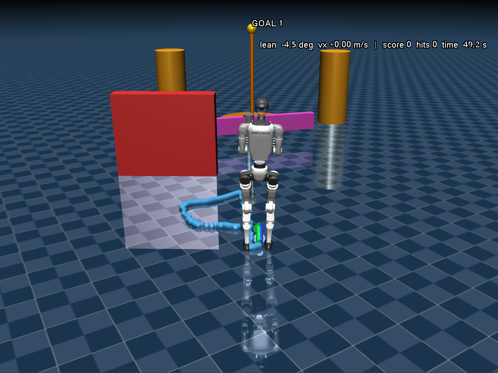

# Advanced Control, An IMU Kalman Filter: Unitree G1 MuJoCo Control

<p align="center">
  
</p>

Control the Unitree G1 humanoid in the MuJoCo simulator using filtered IMU angles. Pitch drives the linear velocity and yaw drives the heading (angular velocity).

This project builds on [unitree_rl_gym](https://github.com/unitreerobotics/unitree_rl_gym) and runs a pre-trained G1 locomotion policy in MuJoCo.

---

## Table of Contents

- [Advanced Control, An IMU Kalman Filter: Unitree G1 MuJoCo Control](#advanced-control-an-imu-kalman-filter-unitree-g1-mujoco-control)
  - [Table of Contents](#table-of-contents)
  - [Requirements](#requirements)
  - [Windows Prerequisites](#windows-prerequisites)
  - [Clone the Repository](#clone-the-repository)
  - [Installation](#installation)
    - [1. Check whether you have Python 3.8](#1-check-whether-you-have-python-38)
    - [2. Install Python 3.8](#2-install-python-38)
    - [3. Create and activate a virtual environment](#3-create-and-activate-a-virtual-environment)
    - [4. Install the project](#4-install-the-project)
    - [5. Verify the installation](#5-verify-the-installation)
  - [Run the Simulation](#run-the-simulation)
  - [Controlling Linear and Angular Velocity](#controlling-linear-and-angular-velocity)
  - [Your Tasks](#your-tasks)

---

## Requirements

| Tool / Package | Version | Notes |
|---|---|---|
| Python | **3.8** | Other versions will not work (numpy 1.20 has no wheels for newer Python) |
| Git | any | Git Bash on Windows |
| MuJoCo | 3.2.3 | Simulator |
| PyTorch | 2.3.1 (CUDA 12.1) | Includes `torchvision 0.18.1` and `torchaudio 2.3.1` |
| NumPy | 1.20.3 | Must be `< 2` |
| PySerial | latest | Serial / Bluetooth communication with the IMU |
| Arduino IDE | latest | *Optional.* Serial monitor and plotter. You can also compile and upload with `arduino-cli` from a terminal |

`pip install` installs all the Python packages for you (see [Installation](#installation)).

---

## Windows Prerequisites

> Not on Windows? Skip to [Clone the Repository](#clone-the-repository).

1. Download and install [Git for Windows](https://git-scm.com/download/win), which includes Git Bash.
   The default options are fine; just click **Next** through the setup. You will paste a lot of commands, so you may want to turn on the copy/paste shortcuts.
2. Open a **Git Bash** window. Run all the commands below in it.

---

## Clone the Repository

```bash
git clone git@github.com:vitormartins02/unitree_rl_gym.git
cd unitree_rl_gym/
```

> Cloning over SSH needs an [SSH key added to your GitHub account](https://docs.github.com/en/authentication/connecting-to-github-with-ssh).
> If you don't have one, clone over HTTPS instead:
> `git clone https://github.com/vitormartins02/unitree_rl_gym.git`

---

## Installation

> **Requirement: Python 3.8.** Other versions will not work.

### 1. Check whether you have Python 3.8

```bash
py -0p
```

If a line with `-V:3.8` appears, skip to [step 3](#3-create-and-activate-a-virtual-environment).

### 2. Install Python 3.8

```bash
winget install Python.Python.3.8
```

If `winget` is not found, try `winget.exe install Python.Python.3.8`, or download the
**Windows installer (64-bit)** from <https://www.python.org/downloads/release/python-3810/>
(do **not** tick *"Add Python to PATH"*).

Then **close and reopen Git Bash** and check again with `py -0p`.

### 3. Create and activate a virtual environment

From the repository root (`unitree_rl_gym/`):

```bash
py -3.8 -m venv .venv
source .venv/Scripts/activate      # Git Bash
# .\.venv\Scripts\Activate.ps1     # PowerShell
python --version                   # must show Python 3.8.x
```

### 4. Install the project

```bash
python -m pip install --upgrade pip
cd deploy/
pip install -e . --extra-index-url https://download.pytorch.org/whl/cu121
```

### 5. Verify the installation

```bash
python -c "import torch, mujoco, serial, numpy; print(torch.__version__, torch.cuda.is_available(), mujoco.__version__, numpy.__version__)"
```

Expected output:

```
2.3.1+cu121 True 3.2.3 1.20.3
```

You can also open the MuJoCo viewer to check that the simulator works:

```bash
python -m mujoco.viewer
```

> **Note:** every time you open a new terminal, activate the environment again
> with `source .venv/Scripts/activate` before running the code.

---

## Run the Simulation

From the `deploy/` folder:

```bash
python deploy_mujoco/teleop_imu_mjc_game.py g1.yaml
```

The config file is loaded from [`deploy/deploy_mujoco/configs/`](deploy/deploy_mujoco/configs/).

---

## Controlling Linear and Angular Velocity

The velocity command is set in [`deploy/deploy_mujoco/configs/g1.yaml`](deploy/deploy_mujoco/configs/g1.yaml):

```yaml
cmd_init: [v_x, v_y, w]
```

| Index | Symbol | Meaning | Driven by |
|---|---|---|---|
| 0 | `v_x` | Forward linear velocity | Filtered **pitch** angle |
| 1 | `v_y` | Lateral linear velocity | (not used) |
| 2 | `w` | Angular (yaw) velocity, i.e. the heading | Filtered **yaw** angle |

Use the Kalman-filtered IMU angles to compute these commands:

- **Pitch → `v_x`:** tilting forward or backward sets the linear speed.
- **Yaw → `w`:** the yaw angle sets the heading, i.e. the angular velocity.

---

## Your Tasks

The project has two parts: the **firmware** on the Arduino estimates the IMU angles, and the
**Python controller** turns those angles into the robot's velocity commands.

```
IMU (gyro, accel, mag) ──► Arduino: Kalman filters ──serial──► deploy_mujoco.py: angles → [v_x, 0, w] ──► G1 policy
        Task 1: deploy/teleop_imu/kfilter_imu/kfilter_imu.ino   Task 2: deploy/deploy_mujoco/teleop_imu_mjc_game.py
```
